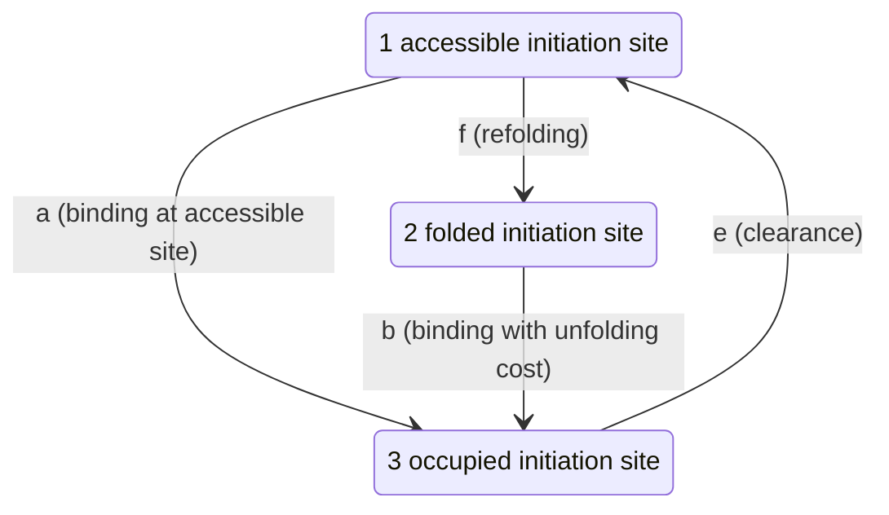

# RBS folding kinetics and ribosome drafting: source admission

- Purpose: Recover the smallest complete drafting calculation and identify missing sequence-to-rate dependencies.
- Scope: Published 2016 theory and historical diagnostic provenance; no runtime or empirical evaluation.
- Last verified: 2026-10-21

The recovered 2016 theory specifies a small stationary calculation **given four
rates on a common time scale**. It does not specify a reproducible automatic
sequence-to-rate correction for the existing RBS predictor. The proposed admission
is an independently written, opt-in **supplied-rate calculation**. Independent
exact-patch review is required before adoption. No runtime is added
here, and no biological accuracy or current hosted-version parity is established.

This addresses the kinetics gap in [RBS mechanisms](rbs-mechanisms.md). It does
not replace the completed [standby](rbs-standby.md) or
[joint-selection](rbs-joint-selection.md) mechanisms. Source and fixture identities
are in [the manifest](../../benchmarks/rbs/kinetics-source-manifest.json) and
[the scalar fixtures](../../benchmarks/rbs/kinetics-scalar-fixtures.json).

## Sources and permitted reuse

Espah Borujeni and Salis, *Translation Initiation is Controlled by RNA Folding
Kinetics via a Ribosome Drafting Mechanism*, JACS 138 (2016), 7016–7023,
[DOI 10.1021/jacs.6b01453](https://doi.org/10.1021/jacs.6b01453), is the primary
mechanism source. Its official theory/methods supplement is sufficient to recover
the stationary equations; the main full text was not obtained.

| Component | Exact identity and access | Reuse boundary |
| --- | --- | --- |
| Official theory/methods PDF | DOI `10.1021/jacs.6b01453.s001`, ACS Figshare record 3398860 v1, file 5310139, `ja6b01453_si_001.pdf`; 997,359 bytes; SHA-256 `a9ded599cbb0313d610267cb9fbdfd21abb1bdb7a467894701fa9b295f3fd6d6` | Official metadata labels it CC BY-NC 4.0. Keep the original external; this is not an unrestricted software licence. Independently expressed mathematics and original derived fixtures are distinct from redistribution of the PDF or its figures/text. |
| Main article | Public official abstract and metadata seen; direct routes returned 403 and indexed full-page access failed | No main PDF, Figure 4A inspection, purchase, login or bypass. Main-only implementation details remain unverified. |
| Historical Salis v1 diagnostic | `hsalis/Ribosome-Binding-Site-Calculator-v1.0`, commit `8a9c1de1bdd847bb90d2ab6ceaa3c20feceda307`, `RBS_Calculator.py`; 49,928 bytes; SHA-256 `a54f94bbe3917ad564e5808ad150311170b57c9b86e5f88c5539a2e0002354b9` | GPL-3.0-or-later header, UC Regents 2008–2009. Read as text only; no original code copied into a runtime or executed. |

The [official supplement record](https://acs.figshare.com/articles/journal_contribution/Translation_Initiation_is_Controlled_by_RNA_Folding_Kinetics_via_a_Ribosome_Drafting_Mechanism/3398860),
[metadata](https://api.figshare.com/v2/articles/3398860) and
[download](https://ndownloader.figshare.com/files/5310139) are pinned separately.
The metadata's [CC BY-NC 4.0 terms](https://creativecommons.org/licenses/by-nc/4.0/)
do not supply an open-source kinetic simulator. No 2016 implementation code was
recovered in these sources. No additional primary reference was needed for the
supplied-rate conclusion. Existing [source decisions](rbs-source-decision.md)
remain unchanged, including the open required-dependency boundary.

## The historical diagnostic is not a kinetic correction

In the pinned v1 source, `calc_kinetic_score` (lines 446–473) takes a structure
and reports `L/N`, where `N` is the nonempty RNA length and `L` is the largest
considered base-pair span, initially zero. It also reports `L**(-1.44)` when
`L>0`, otherwise 1. For valid pairs `1 <= x < y <= N`, `0 <= L/N < 1`.
Both are dimensionless structure diagnostics. Neither supplies seconds, a
transition-rate prefactor or a folding trajectory. The source explicitly warns
that the heuristic omits cooperative folding processes and cannot quantify RNA
folding kinetics.

`calc_dG` computes total energy before the separate diagnostic (lines 727–731).
`calc_expression_level` (799–802) uses `2500*exp(-dG/2.222)`, without the diagnostic.
This source therefore does not justify multiplying an expression score by `L/N`,
using its inverse as a folding time, or labelling it a drafting correction.
These are static observations of historical source, not a claim about the current
hosted calculator or every historical design workflow.

## Recoverable model and assumptions

The supplement's printed S15 has three stationary balances; S16 equation S11
defines throughput. State identities follow from those balances and the adjacent
rate definitions. State 1 means an accessible initiation site, not necessarily a
fully unstructured transcript: S14 allows local pre-SD and post-footprint folds.



Use `a=a1`, `b=a2`, `f=a_fold`, `e=a_elong`, all in the **same inverse-time unit**.
These are effective first-order hazards. Any underlying association coefficient
would need its concentration factor before use here. `e` is clearance of the
initiation region, not codons/second or completion of a full protein.

The model assumes constant rates, memoryless coarse states and stationary
occupancies. It has no separate spontaneous F-to-U unfolding, dissociation,
transcript synthesis/degradation, standby-occupancy state, multiple-site traffic,
or per-codon elongation. The S16–S18 discussion motivates neglecting spontaneous
unfolding; it does not show that this rate is zero for arbitrary RNAs. Adding an
edge would change the model. The paper assumes `e>a`; supplying slower clearance
would extend beyond that stated regime even though the algebra can remain defined.

The smallest recommended future domain is `a>0`, `b>0`, `e>a`, `f>=0`, with
explicit common units and rate provenance. `f=0` is a synthetic mathematical
boundary, not a measured claim. Do not silently handle zero binding/clearance by
substitution: some zero-rate graphs have nonunique stationary distributions.
An API, numerical limits and runtime validation still require A's separate review.
The inhibitory-folding interpretation additionally requires `a>=b`; the algebra
at `b>a` predicts the opposite response and must not be labelled drafting enhancement.

## Independently derived stationary calculation

The source balances and the required probability normalization are:

```text
e P3 - (a+f) P1 = 0
f P1 - b P2 = 0
a P1 + b P2 - e P3 = 0
P1 + P2 + P3 = 1
```

The three homogeneous balances are dependent; normalization is an explicit
derivation step. For the positive binding/clearance domain above, define
`D=e(b+f)+b(a+f)`. Direct solution gives:

```text
P1 = b e / D
P2 = f e / D
P3 = b (a+f) / D
J  = e P3 = e b (a+f) / D = a P1 + b P2
```

`D` and the probability numerators have units time^-2; `P1..P3` are dimensionless
and sum to one; `J` has units time^-1. The independent renewal derivation has
mean cycle duration `1/e + (b+f)/(b(a+f))`, whose inverse is the same `J`.
No folding backend, RNA sequence or energy input is required for this algebra.

`J` is stationary initiation-site throughput. It is neither an absolute protein
expression measurement nor automatically in seconds. During a transient,
`a*p1(t)+b*p2(t)` and `e*p3(t)` differ by `dp3/dt`; S11 must not be repurposed as
instantaneous binding flux. Transients would additionally require an initial
distribution and a time interval; none are evaluated here.

| Check | Derived result | Interpretation |
| --- | --- | --- |
| `f -> 0` | `J -> ea/(e+a)` | Competition-free accessible-site limit, still clearance limited. |
| `f -> infinity` | `J -> eb/(e+b)` | Fully refolded cycle limit; equals `b` only in the further fast-clearance limit. |
| `e -> infinity` | `J -> b(a+f)/(b+f)` | Removes occupancy delay, not folding competition. |
| `a=b` | `J=ea/(e+a)` | Folding does not change throughput when the two binding rates agree. |
| All rates multiplied by `c>0` | Same probabilities, `J` multiplied by `c` | Relative rates cannot determine an absolute timescale. |
| Differentiate in `f` | `dJ/df=e^2*b*(b-a)/D^2` | Slower refolding increases throughput only when `a>b`. |
| Finite positive rates | `0<J<e` | Clearance bounds throughput. |

The optional dimensionless ratio `J/[eb/(e+b)]` compares two limits of this same
four-rate model. Fast refolding is an operational limit of a driven cycle, not
detailed-balance equilibrium of the whole graph. The assumption `e>a` alone does
not justify replacing finite clearance by infinity. The ratio is not an admitted
multiplier on the existing relative RBS
score. That score's scale, energetic decomposition and clearance assumptions
would first have to be reconciled.

Six original scalar fixtures use arbitrary, common inverse-model-time units,
with exact rational expected probabilities and fluxes. They cover equal binding,
finite competition, zero/strong refolding, common scaling and finite clearance.
They contain no RNA sequences, empirical outcomes or fitted constants. Gaussian
elimination of the balances plus normalization was checked independently of the
closed form; these are algebra checks, not accuracy benchmarks.

## Energetic equations do not complete the kinetic inputs

Using `G` for the paper's signed molar free-energy changes (kcal/mol), S14–S15 give:

```text
S5:  Gtotal = Gcomplex - Grefold
S6:  Gcomplex = GSD-antiSD + Gspacing + Gstandby + Gstart
S7:  Grefold = GmRNA - Gpre-SD - Gpost-footprint
S8:  Grefold,actual = Grefold - Gpost-footprint
S9:  a = A exp(-beta Gcomplex)
S10: b = A exp[-beta (Gcomplex - Grefold)]
```

S15 sets `beta=0.45 mol/kcal` and chooses `A=100`. Although the prose calls beta
a Boltzmann constant, its units make it an inverse molar-energy coefficient;
no new temperature law follows. `A` must have the binding-rate unit. The
supplement gives no calibration to seconds. Its separate equilibrium multiplier
`K` (S13 S1) is not specified numerically there and must not be equated to `A` or
the historical score's 2500.

S7 normally gives a negative signed refolding energy. Then
`b/a=exp(beta*Grefold)<=1`. Supplying a positive unfolding-cost magnitude in its
place reverses the intended relationship. S8 subtracts the post-footprint energy
already present in S7, while S10 explicitly references S7. Whether these use
different intermediate conventions is unresolved in the recovered text. Neither
literal double subtraction nor a presumed typo is silently adopted.

S3 Figure S2 approximates folding by an exponential first-passage distribution,
using the inverse mean of 1,000 trajectories. S11 section 1.5 starts Kinfold at a
fully unfolded RNA and stops on first reaching its minimum-free-energy structure.
This differs from the partially structured accessible state allowed in S14.
The reported times are arbitrary units. No admitted conversion aligns them with
binding and clearance rates. Equal equilibrium energies constrain an equilibrium
rate ratio, not absolute rates: scaling both forward and reverse rates leaves the
ratio unchanged while changing every timescale.

The following block automatic sequence-derived admission:

1. No complete pinned, open, accepted folding-kinetics implementation/configuration
   or exact kinetic time conversion was recovered. The supplement names Kinfold
   and ViennaRNA (1.8.5 for energy calculation); this is not a new required
   dependency admission. Equilibrium RNAstructure folding alone cannot supply `f`.
   Kinfold's exact component version and applicable code terms were not verified
   here; they are not inferred from ViennaRNA 2.7.2 or an umbrella package licence.
   The task's restriction on introducing a required dependency is an output
   boundary, not a finding that separately distributed components share terms.
   Any later component decision must pin its own source and terms for the
   first-passage trajectory operations described above; until then it is unadmitted.
2. The absolute/common binding-rate scale, clearance value and alignment to `f`
   are missing. `e>a` is an inequality, not a value. Choosing an arbitrary
   clearance multiple would add an outcome-independent but unsupported constant.
3. The S7/S8 accounting, exact context/footprint coordinates, structure search/ties
   and relationship between the kinetic initial state and accessible-site state
   need resolution. Replacing them with later standby/footprint profiles would
   create a new model, not historical fidelity.
4. Figure S6's illustrative `f=20/2000` and energy sweeps are arbitrary-unit theory
   settings, not host-transfer parameters. Missing clearance/plot normalization
   and inaccessible main-text details prevent a claimed exact plot reproduction.

For example, S6's weak-binding `Gcomplex=0.8`, with S9's `A=100` and `beta=0.45`,
implies `a=69.7676326071` in model units. Its negative refolding-energy range gives
`b<a`, so the unscaled stationary flux cannot exceed `a`; the rendered curve
nevertheless reaches approximately 1000 arbitrary units. An additional scale or
convention is needed. This is a gap in the recovered plot specification, not a
claim that an inaccessible main-text explanation is wrong. No plotted values are
admitted as expected fixtures.

Thus an open original scalar implementation needs only ordinary arithmetic and
caller-supplied rates. A general RNA-sequence implementation is **not admitted**
by this evidence. No equilibrium-energy-only timescale is substituted for the
missing kinetic inputs.

## Future evaluation and exposure boundary

Source admission demonstrates a specified calculation, not improved prediction.
Any future candidate must freeze code, model/profile identity, rate provenance,
units, permitted contexts, handling of unsupported cases and comparator settings
before an independent experimental test. Translation-initiation or protein-output
measurements must be distinguished from transcript abundance and clearance;
host conditions and measurement uncertainty matter. A supplied-rate demonstration
cannot establish sequence-prediction accuracy. Adding a sequence-to-rate model
would need its own source/backend admission before such a test.

The official abstract and supplement expose public result summaries, figures and
method descriptions; this paper is **not untouched evaluation evidence** for this
session. The companion data-record metadata was inspected only to identify its
file and terms; the outcome spreadsheet was not downloaded or read. No empirical
panel, threshold, fit, predictor run or private outcome was used. Previously
consumed RBS cohorts remain consumed. The source ledger records failed/empty
HTTP bodies as well as useful sources; opaque search-service traffic is not
misrepresented as a measured download byte count.

## Reproducibility boundary

The manifest records exact scientific source bytes, retrieved metadata/terms,
public download accounting, derived-fixture identity, locations and unresolved
dependencies. Originals remain in the explicit external cache; no PDF, spreadsheet
or third-party code is redistributed in Git. Manifest validation must reject
duplicate JSON keys, nonfinite numbers, malformed types, missing required pins
and byte/hash mismatches. Recompute synthetic expectations from the stationary
balances, not by changing their stored values to match a runtime under test.

Focused verification covers source hashes, all six rational scalar cases,
dimensions/limits, source/fixture manifest structure, local links, ticket/index
consistency and whitespace. No existing runtime tests were changed or rerun:
this package contains no runtime or test implementation. Independent review is
required before an admission handoff; its exact reviewed commit and report are
recorded separately so mutable review status does not alter immutable source pins.
